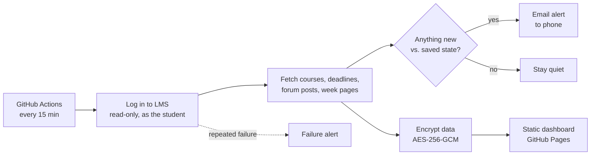

# CampusPing

**Never miss a deadline, handout or announcement on your university LMS again.**

CampusPing watches a Moodle-based LMS for you and pings your phone the moment something new appears: a deadline, a handout, an announcement, a changed due date. It runs automatically in the cloud for free, even when your laptop is off.

> Unofficial personal project, not affiliated with or endorsed by any university. See [Disclaimer](#disclaimer).

---

## The problem

University LMS platforms are where slides, assignments, quizzes and announcements live, but they only help if you remember to open them. In practice, students check irregularly, and important things get missed: a deadline moved forward, a handout posted the night before a quiz, a class cancelled because of rain.

A browser extension doesn't solve this. It only works while the laptop is on and the browser is open, and it can't reach your phone. The real fix is something that checks **on its own, around the clock**, and sends a notification to the device you already look at all day.

## What it does

| | |
|---|---|
| ⏰ **Deadlines** | Reads upcoming deadlines up to ~2 years ahead. Alerts on new deadlines and on **changed** due dates, with reminders at 24 hours and 3 hours before. Submitted work drops off automatically. |
| 📄 **New material** | New files, assignments, quizzes and links in every enrolled course. Alerts show the real file name and open the real destination (for example a shared Drive link) instead of an intermediate LMS page. |
| 📣 **Announcements and posts** | New forum posts are checked every 15 minutes, so a cancelled class or a quiz marksheet reaches you quickly. |
| 🕵️ **Hidden handouts** | Finds handouts that teachers embed inside week text blocks (invisible to a plain course listing), and detects when the wording of a week block is edited. |
| 🔎 **Catch-up summary** | On first run it sends one summary of everything older it found, instead of flooding you with dozens of alerts. |
| 📊 **Private dashboard** | A small web page with countdowns, recent alerts and one card per course. Data is encrypted and only unlocks in your browser with your passphrase. |
| 🚨 **Failure alerts** | If it can no longer read the LMS (password changed, site down, layout changed), it emails you instead of going silent. Silence should never be mistaken for "nothing new". |
| 🎛️ **Per-course control** | Ignore courses you dropped with a one-line setting. |

Alerts arrive by **email** (Gmail push works instantly on both Android and iPhone, with nothing extra to install). Optional channels: ntfy push notifications and Telegram.

## How it works



1. **Scheduled run.** A GitHub Actions workflow runs every 15 minutes. No server to maintain.
2. **Read-only login.** It signs in with the student's own credentials (stored as encrypted GitHub secrets) and only reads pages the student can already see. It never submits, clicks completion buttons or changes anything.
3. **Collect.** It uses the LMS's own web endpoints for the course list, per-course contents and the deadline timeline, plus page parsing for forum posts and week pages.
4. **Diff.** Everything is given a stable ID and compared with the previous run. Only genuinely new or changed things trigger an alert.
5. **Notify.** Alerts go out by email (and optionally ntfy or Telegram).
6. **Publish.** The latest data is encrypted and committed for the static dashboard.

## Engineering notes

A few problems that shaped the design:

- **Missing content: handouts hidden in text blocks.** The first version trusted the course listing and missed a course's handouts entirely, because the teacher had placed them as links inside week text blocks. Fix: a deeper scan of each week page that extracts links inside those blocks and fingerprints their wording to detect edits.
- **The calendar export is not enough.** The LMS's calendar export only covers about 60 days ahead, so it can't see later semesters. Fix: read deadlines from the dashboard timeline endpoint, which looks far further ahead and excludes work already submitted.
- **Forums looked "unchanged".** A forum is one item whether it holds 0 or 100 posts, so new announcements never triggered anything. Fix: read the discussion list of each forum on every run.
- **Being polite to the server.** The deep scan opens roughly 130 pages, so it runs hourly while the cheap checks run every 15 minutes. Requests are limited to 4 in parallel with retries.
- **Avoiding false alarms.** Per-student interface text (such as "Mark as done") is stripped before fingerprinting, so ticking a box can never look like a teacher's edit. A re-scan with no changes sends nothing.
- **Public repo, private data.** The repository is public (free, unlimited Actions minutes and Pages), but the dashboard data is encrypted with AES-256-GCM using a PBKDF2-derived key (200,000 iterations) and decrypted client-side in the browser. Credentials live only in GitHub Secrets; the saved state holds opaque item IDs only.
- **Never fail silently.** Consecutive failures trigger an email after about 45 minutes, a daily reminder while broken, and a message on recovery.

## Tech stack

- **Python 3.12**: `requests`, `beautifulsoup4`, `cryptography`
- **GitHub Actions** for scheduling and state persistence
- **GitHub Pages** with vanilla HTML/CSS/JS and the Web Crypto API for the dashboard (no frameworks, no build step)
- **SMTP (Gmail app password)** for alerts, with optional ntfy and Telegram

## Project structure

```
main.py            orchestration: collect, diff, alert, failure handling
lms.py             LMS login and low-level helpers
deep.py            hidden handouts, forum posts, text-change fingerprints
dashboard.py       builds the encrypted dashboard data
docs/index.html    the dashboard (static page, decrypts in the browser)
.github/workflows/check.yml   15-minute schedule
```

## Set it up for yourself

This is built for a Moodle-based LMS and was tested against one university's setup. Other Moodle sites may need small adjustments.

1. **Fork or copy** this repository.
2. In **Settings → Secrets and variables → Actions**, add:
   - `LMS_USER`: your student ID
   - `LMS_PASS`: your LMS password
   - `EMAIL_USER`: the Gmail address that receives alerts
   - `EMAIL_APP_PASS`: a Gmail [app password](https://myaccount.google.com/apppasswords) (needs 2-Step Verification)
   - `DASH_KEY`: a long random passphrase that locks the dashboard (4+ unrelated words)
3. In **Settings → Pages**, deploy from branch `main`, folder `/docs`.
4. Update `LMS_BASE` to your LMS address if it isn't the default.
5. Open **Actions → CampusPing check → Run workflow** once. You'll get a "connected" email, then a catch-up summary.
6. Open your Pages link, enter your `DASH_KEY`, and you have your dashboard.

To ignore dropped courses, edit the `EXCLUDE` line in `main.py` (matched against the start of the course code).

Run it locally instead: put the same values in a `.env` file (never commit it), then `python main.py --once`. Add `--dry` to print alerts instead of sending them.

## Limitations

- Notifications are as fast as the schedule allows: forum posts and deadlines within about 15 minutes, hidden handouts and edited text within about an hour. GitHub's scheduler can also run a few minutes late.
- It can't see a file that is silently replaced by a new version, replies inside an existing forum thread, or the gradebook.
- It depends on how the LMS is built. If the university changes its layout, parts of the scan may need updating (the failure alert will tell you).
- Files uploaded directly to the LMS still require you to be logged in to the LMS in your browser. External links (such as Drive) open directly.
- It's a personal tool. Supporting many students would need a different, privacy-first design where logins never leave each student's device.

## Roadmap

- Weekly summary email
- Push notifications through an installable web app
- Per-course alert settings
- Support for other Moodle layouts

## Disclaimer

CampusPing is an unofficial, personal project. It is not affiliated with, endorsed by, or supported by any university or Moodle. It only reads information that the signed-in student can already see, makes a small number of read-only requests, and never submits or changes anything. Use it only with your own account, in line with your institution's acceptable-use rules, and always confirm important deadlines on the official LMS.
